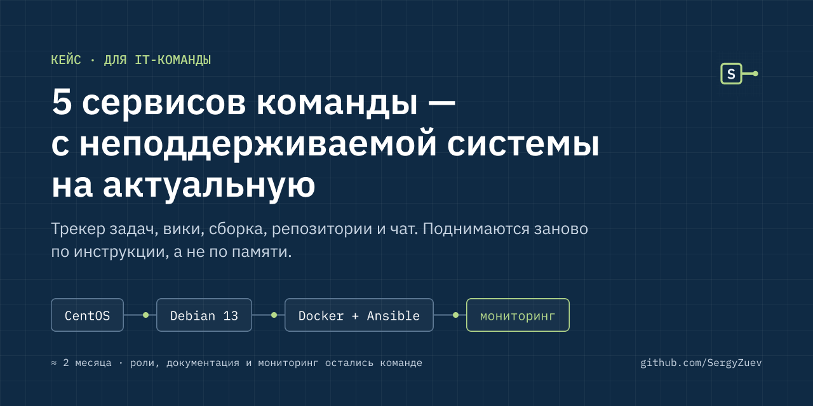

# 5 сервисов команды — с неподдерживаемой системы на актуальную

**Для кого:** IT-команды без своего DevOps · **Срок:** около 2 месяцев · **Команда:** я и коллега на подстраховке

## Было

Рабочие сервисы команды разработки — трекер задач, вики, сборка кода, репозитории, чат — работали на CentOS. Её больше не поддерживают: нет обновлений безопасности, версии сервисов устарели.

## Что сделал

Перевёл 5 сервисов на Debian 13 и актуальные версии, упаковал в Docker, описал развёртывание Ansible-ролями — теперь сервис поднимается заново по инструкции, а не по памяти. Настроил мониторинг в Zabbix, сертификаты, сеть и перенаправления.

## Что пришлось решить по ходу

При смене системы и версий часть различий проявляется только в реальной работе. Два таких случая:

- **Контейнеры и фаервол.** На Debian сеть устроена иначе, чем на CentOS, и правила, которые создаёт Docker, конфликтовали с настройками фаервола. Перестроил сетевую конфигурацию так, чтобы контейнеры и защита сервера работали вместе.
- **Повторные сборки после переноса репозиториев.** После переезда системы контроля версий сборки начали запускаться дважды, и сервер сборки не выдержал нагрузки. Устранил причину дублей, а сервер восстановил из ночной резервной копии и вернул в работу.

Поэтому в таких проектах заранее закладываю резервные копии и возможность отката — во втором случае именно они позволили быстро восстановить работу.

## Стало

Сервисы на поддерживаемой системе: закрыты риски безопасности, есть обновления, поддержка и новые возможности.

**Команде остались:** роли, документация, мониторинг.

---

Похожая задача? Начну с аудита: что в порядке, что рискованно, что делать первым.
Telegram: [@SergyyZuev](https://t.me/SergyyZuev) · [Все кейсы](README.md) · [Все проекты](https://github.com/SergyZuev)
